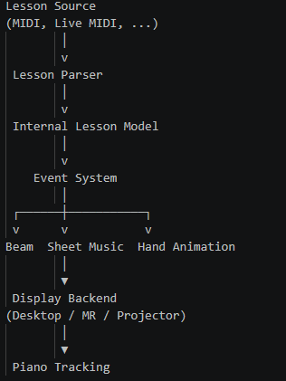

# ARPianoFramework

ARPianoFramework is a modular and extensible piano-instruction framework built with **Unity 6** and **C#**. It combines MIDI lesson playback, live MIDI input, piano-note visualization, webcam-based keyboard alignment, and session recording in a single prototype.

The project is intended as a research and development platform for immersive piano instruction. Its current workflow is designed for desktop use, while the architecture leaves room for future mixed-reality and head-mounted-display integration.

## Features

- **MIDI lessons:** Load MIDI lesson files and represent their notes, timing, and duration in the framework's lesson model.
- **Lesson playback:** Play lessons, pause and resume playback, and coordinate note events with the visualization.
- **Live MIDI input:** Receive notes from a connected USB MIDI keyboard.
- **Virtual piano:** Display an 88-key virtual keyboard and map MIDI notes to piano keys.
- **Note visualization:** Display animated beams that correspond to lesson notes or live MIDI input.
- **Manual keyboard calibration:** Use four draggable points to mark the physical keyboard's corners in the webcam image. Calibration data is saved locally and restored in later sessions.
- **Recording:** Save MIDI input and screen video. The framework can also render piano audio from the recorded MIDI and combine that audio with the video.
- **Experimental computer vision:** An OpenCV/OpenCvSharp keyboard-detection implementation is included for experimentation. Manual calibration is the current primary workflow.

## Technologies

| Area | Technologies |
|---|---|
| Engine and language | Unity 6, C#, .NET |
| MIDI | DryWetMIDI, USB MIDI input |
| Interface and visualization | Unity UI, TextMeshPro, `RectTransform` |
| Camera | `WebCamTexture` |
| Experimental tracking | OpenCV, OpenCvSharp |
| MIDI audio rendering | FluidSynth, FluidR3 GM SoundFont |
| Media processing | FFmpeg, FFmpegUnityBind2 |
| Version control | Git |

## Repository layout

The Unity project is located inside the repository at:

```text
ARPianoFramework/
└── framework/
    └── ARPIANO/
        ├── Assets/
        ├── Packages/
        └── ProjectSettings/
```

Open **`framework/ARPIANO`** as the Unity project directory. Do not open the repository root as the Unity project.

## Developer setup: clone and open the Unity project

### Requirements

- Windows 10 or Windows 11, 64-bit.
- Git.
- Unity Hub.
- **Unity Editor 6000.4.6f1**.
- Unity's Windows Build Support module if you intend to create a Windows standalone build.
- An internet connection for the initial Unity package restore.
- A webcam and MIDI input device for testing the corresponding features.

Use the Unity Editor version recorded in `ProjectSettings/ProjectVersion.txt`. A different Unity version may upgrade project files or packages.

### 1. Clone the repository

Clone the repository using the URL provided by the Git hosting service:

```bash
git clone <repository-url>
```

### 2. Open the Unity project

In Unity Hub:

1. Select **Add** or **Add project from disk**.
2. Browse to the cloned repository.
3. Select the `framework/ARPIANO` folder.
4. Open the project with Unity **6000.4.6f1**.
5. Wait for Unity to import the assets and resolve the packages.

The first import can take some time. Open the scene manually from the Project window:

```text
Assets/Scenes/SampleScene.unity
```

Unity does not necessarily open this scene automatically when the project is first added to Unity Hub.

### 3. Install FluidSynth for audio recording

The FluidSynth runtime and SoundFont are distributed separately from the Git repository because they are large third-party dependencies.

1. Open the project's [GitHub Releases](https://github.com/Andynowitz/ARPianoFramework/releases) page.
2. Download the `FluidSynth-Windows-x64.zip` release asset.
3. Extract the contents of the ZIP into:


```text
Assets/StreamingAssets/FluidSynth/
```

After extraction, the folder should contain the runtime files directly (not an additional nested `FluidSynth` folder):

```text
Assets/StreamingAssets/FluidSynth/
├── fluidsynth.exe
├── libfluidsynth-3.dll
├── SDL3.dll
├── sndfile.dll
└── FluidR3_GM.sf2
```

Keep the filenames expected by the project. If a newer FluidSynth distribution uses different DLL names or dependencies, it may require corresponding configuration changes.

Without this folder, the project can still be opened and other functionality can be used, but MIDI-to-WAV rendering and the piano-audio portion of combined recordings will not work. Video recording and MIDI file saving are separate functions.

### 4. FFmpeg

The project includes FFmpegUnityBind2 and its Windows desktop runtime archives under `Assets/StreamingAssets`. The integration extracts the required runtime files when needed. A separately installed FFmpeg executable should not normally be necessary for the tested Windows workflow.

Do not remove or rename the committed FFmpeg runtime archives.

### 5. Windows x64 MIDI plugin import setting

The native DryWetMIDI plugin must be included in Windows x64 standalone builds.

In the Unity Project window, locate:

```text
Melanchall_DryWetMidi_Native64.dll
```

Select the DLL and inspect its Plugin Import Settings. The tested configuration is:

- **Any Platform:** disabled.
- **Editor:** enabled for x86_64.
- **Standalone:** enabled for x86_64.
- **Windows x86:** disabled.

The plugin's `.meta` file stores its import settings. Ensure the updated `.meta` file is committed to Git so that a fresh clone receives the same configuration. If the setting is missing after cloning, apply it in the Inspector and commit the resulting `.meta` change.

### 6. Build the Windows application

1. Open **File → Build Profiles**.
2. Select the Windows platform.
3. Confirm that `Assets/Scenes/SampleScene.unity` is included and enabled in the Scene List.
4. Select the required architecture, normally Windows x86_64.
5. Choose a build output folder outside the Unity project if desired.
6. Build and wait for Unity to finish.

A Unity standalone build consists of the executable and its accompanying data and runtime files. Distribute the **entire build output**, not only the `.exe`.

## End-user setup: run the Windows application

This guide is for someone who wants to use the compiled application without opening the Unity project.

### Requirements

- Windows 10 or Windows 11, 64-bit.
- A webcam.
- A USB MIDI keyboard or another supported MIDI input device.
- The complete Windows build folder supplied with the application.

### 1. Extract the application

Download or receive the Windows build archive and extract the **entire folder** to a location where the user has permission to write files, for example:

```text
C:\Users\<username>\Applications\ARPianoFramework\
```

Do not move the `.exe` out of its build folder or distribute the executable on its own.

### 2. Connect the devices

1. Connect the webcam.
2. Connect and power on the MIDI keyboard.
3. Close other applications that may be using the MIDI input device.
4. Start ARPianoFramework.

The current implementation selects the first available webcam and MIDI input device. If several devices are connected, the application may select a different device than expected.

### 3. Open the framework

Run `ARPIANO.exe` (or the executable name supplied with the build). Allow Windows to access the webcam if a permission prompt appears. If the camera feed is unavailable, check that Windows recognizes the camera and that another application is not using it.

### 4. Calibrate the physical keyboard

The primary calibration method is manual:

1. Open the calibration interface.
2. Make sure the webcam image is visible.
3. Move the four calibration points onto the physical keyboard's corners:
   - top-left,
   - top-right,
   - bottom-right,
   - bottom-left.
4. Confirm the calibration.
5. Check that the virtual keyboard and note-position markers align with the physical keys.
6. Use **Calibrate Again** if the camera or piano is moved.

Calibration is stored locally and restored in later sessions. A calibration made on one computer should not be assumed to match another computer's camera placement or physical piano setup. Recalibrate after changing the camera position, camera, or piano position.

### 5. Load and play a lesson

Select one of the available MIDI lessons in the lesson interface and start playback. The lesson files supplied with the project are stored in:

```text
Assets/StreamingAssets/Lessons/
```

Additional MIDI lesson files can be placed in the lesson folder if the application is configured to read them from its StreamingAssets directory.

### 6. Record a session

Use the recording interface to start and stop a session. Depending on the selected recording mode, the framework can save:

- a Standard MIDI File (`.mid`);
- a screen recording (`.mp4`);
- a combined MP4 containing the screen recording and piano audio rendered from the MIDI performance.

The combined audio/video workflow requires the FluidSynth runtime and FluidR3 GM SoundFont to be present in the build's StreamingAssets folder. When preparing a distributable build, include the `FluidSynth` folder at:

```text
<BuildName>_Data/StreamingAssets/FluidSynth/
```

Preserve the complete Unity build folder structure. If the FluidSynth folder is omitted, the application can report that the runtime or SoundFont is missing and the piano-audio rendering step will fail.

Recording output is written to the application's persistent data directory rather than the installation directory. On Windows, this is normally under:

```text
%USERPROFILE%\AppData\LocalLow\<CompanyName>\<ProductName>\Recordings\
```

The exact company and product folder names depend on the Unity Player Settings used for the build. Users do not need write permission inside `Program Files` for recordings to be saved.

## Recording workflow

The combined MIDI and video recording process is:

1. Capture MIDI note events and their timing.
2. Save the events as a Standard MIDI File.
3. Finish encoding the screen recording.
4. Use FluidSynth to render the MIDI file into temporary WAV audio.
5. Use FFmpeg to combine the rendered piano audio with the recorded video.
6. Save the final MP4.

The piano audio is synthesized from the recorded MIDI events; it is not captured from a physical piano microphone.

| Recording mode | Output |
|---|---|
| MIDI only | `.mid` |
| Video only | `.mp4` without generated piano audio |
| MIDI and video | `.mid` and `.mp4` with synthesized piano audio |

## Keyboard calibration

The current primary calibration workflow uses four manually positioned points in the webcam image. The positions are converted from UI coordinates into camera/image coordinates and used to establish the keyboard mapping for the virtual piano and note visualization.

The calibration is stored locally and restored in later sessions. Because the calibration describes a particular camera and physical piano arrangement, each new computer or changed camera setup should be calibrated independently.

The OpenCV/OpenCvSharp keyboard-detection implementation is experimental. It is not the primary calibration workflow and should not be relied on as a fully validated automatic calibration method.

## Known limitations

- The current supported and tested deployment target is Windows x64.
- The webcam and MIDI input implementations select the first available device; device selection is not currently presented as a configurable setup workflow.
- Manual calibration is the primary supported keyboard-alignment method.
- OpenCV-based automatic keyboard detection is experimental.
- FluidSynth and the FluidR3 GM SoundFont are distributed separately from the Git repository. Download the Windows x64 archive from the [GitHub Releases](https://github.com/Andynowitz/ARPianoFramework/releases) page and extract it into the expected location.
- The project has been opened and tested from a fresh Git clone and a Windows standalone build on the development computer. A separate physical-PC test has not yet been performed.
- Meta Quest deployment and the complete mixed-reality workflow are future work.

## Third-party software and licences

This project uses third-party software, packages, native libraries, and audio assets. Their licences are separate from any licence that may apply to ARPianoFramework.

See [`THIRD-PARTY-LICENSES.md`](THIRD-PARTY-LICENSES.md) for the project's licence inventory and attribution notes.

Important dependencies include:

- **DryWetMIDI** — MIDI file processing and MIDI input/output functionality.
- **FluidSynth** — MIDI synthesis and WAV rendering.
- **FluidR3 GM SoundFont** — General MIDI instrument samples.
- **FFmpeg** — audio/video processing.
- **FFmpegUnityBind2** — Unity integration for FFmpeg.
- **OpenCvSharp / OpenCV** — experimental computer-vision functionality.
- **Unity and Unity packages** — subject to Unity's and the respective package authors' terms.

Before redistributing a project or standalone build, verify the exact versions, bundled binaries, licence texts, attribution requirements, and redistribution permissions for every dependency. In particular, verify the terms for the FFmpeg build and the FluidR3 GM SoundFont before distributing them.

## Architecture

The framework is organized around several logical responsibilities:

- **Lesson system:** Loads MIDI lessons and represents notes using internal models.
- **Lesson playback:** Tracks playback time and emits note-start and note-stop events.
- **Virtual piano:** Maps MIDI notes to piano keys and displays their active state.
- **Visualization:** Represents notes as animated beams moving toward their target keys.
- **Keyboard tracking and calibration:** Establishes the keyboard's position in the camera image using manually positioned UI points.
- **Recording:** Captures MIDI input and video, optionally rendering MIDI audio and combining it with the video.

The architecture uses interfaces and event-driven communication to reduce dependencies between components. Further work is needed before every module can be replaced independently.



## Future development

Potential future work includes:

- Meta XR SDK integration and Meta Quest deployment.
- Mixed-reality display and interaction.
- Synchronized virtual hands and hand tracking.
- Additional lesson formats and lesson-authoring tools.
- Further separation and interchangeability of tracking and visualization modules.
- More robust automatic keyboard detection, if a reliable approach can be established.
- Improved recording error recovery and temporary-file cleanup.
- Cross-platform audio rendering and deployment.
