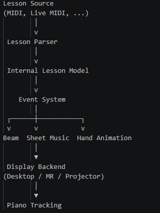

# ARPianoFramework

## COMMITING

```bash
git push origin andy/setup
git push github andy/setup

git push -u origin ffmpeg-fix
git push -u github ffmpeg-fix
```

## Overview

ARPianoFramework is a modular and extensible framework for Mixed Reality (MR) piano instruction developed with Unity 6 and C#.

The project consolidates piano visualization, MIDI lesson playback, keyboard tracking, and recording into a common framework. It is intended as a research and development platform for immersive piano instruction across desktop and future head-mounted display (HMD) environments.

The framework currently includes MIDI lesson parsing and playback, an 88-key virtual piano, animated note beams, manual keyboard calibration using virtual UI points, and recording of MIDI input and screen video with optional synthesized piano audio.

The architecture is designed to support interchangeable modules for lesson authoring, visualization, display, and tracking.

## Technologies

### Core framework
- Unity 6
- C# / .NET
- Git

### MIDI and lesson processing
- DryWetMIDI — MIDI file parsing, note events, and MIDI file generation
- USB MIDI keyboard input
- Internal `PianoNote` and `Lesson` models
- Event-driven note playback and visualization

### Visualization
- Unity UI and `RectTransform`
- Virtual 88-key piano
- Animated note beams
- Configurable beam movement and note-duration visualization

### Keyboard tracking and calibration
- Webcam input
- Manual calibration using four virtual UI points
- Conversion between UI positions and camera/image coordinates
- Keyboard corner mapping for the virtual piano
- OpenCV / OpenCvSharp — earlier experimental keyboard-detection approach; not the current primary strategy and not yet considered reliable

### Recording and audio
- MIDI recording to Standard MIDI Files (`.mid`)
- Screen recording to MP4
- FluidSynth — offline rendering of MIDI into WAV audio
- FluidR3 GM SoundFont — General MIDI instrument sounds
- FFmpeg / FFmpegUnityBind2 — media processing and combining rendered piano audio with recorded video

### Planned technologies
- Meta XR SDK
- HMD deployment and mixed-reality display integration
- Additional tracking and display modules as required

## Planned Architecture



The framework is designed to be modular. Every major component should be replaceable without unnecessarily affecting the remaining system.

The main logical components are:

- **Lesson system:** Loads MIDI lessons and represents notes using internal models.
- **Lesson playback:** Tracks playback time and emits note-start and note-stop events.
- **Virtual piano:** Maps MIDI notes to the corresponding keys and displays their active state.
- **Visualization:** Represents notes as animated beams that move toward their target piano keys.
- **Keyboard tracking and calibration:** Establishes the keyboard's position in the camera image using manually positioned UI points.
- **Recording:** Captures MIDI input and video, optionally rendering the recorded MIDI into piano audio and combining it with the video.

These components form the intended architecture. Further work is required to make all modules independently replaceable and validate the complete mixed-reality pipeline.

## Development Workflow

Development proceeds incrementally. Each milestone should produce a working prototype before additional functionality is introduced.

# Milestone 1 – Project Foundation

- [x] Create Unity project
- [x] Design folder structure
- [x] Define initial interfaces
- [x] Create core models (`PianoNote`, `Lesson`)
- [x] Set up Git repository
- [x] Establish the initial modular project architecture

# Milestone 2 – MIDI & Lesson System

- [x] Integrate DryWetMIDI
- [x] Parse MIDI files
- [x] Convert MIDI notes into `PianoNote`
- [x] Create `Lesson` objects
- [x] Print parsed notes for debugging
- [x] Represent MIDI note pitch, timing, and duration in the internal lesson model

# Milestone 3 – Lesson Playback

- [x] Create `LessonPlayer`
- [x] Implement an internal playback timer
- [x] Trigger `NoteStarted`
- [x] Trigger `NoteStopped`
- [x] Implement pause and resume
- [x] Implement stop playback
- [x] Expose note events for visualization and other subscribers

# Milestone 4 – Virtual Piano

- [x] Create an 88-key virtual keyboard
- [x] Create the `PianoKey` component
- [x] Map MIDI notes 21–108 to piano keys
- [x] Connect the virtual piano to lesson playback
- [x] Highlight pressed keys
- [x] Release highlighted keys when notes stop

# Milestone 5 – Note Visualization

- [x] Create the initial beam visualizer prototype
- [x] Spawn beams in response to note-start events
- [x] Handle note-stop events
- [x] Support simultaneous notes and chords
- [x] Implement beam movement toward target piano keys
- [x] Establish the beam coordinate system
- [x] Align beam endpoints with the target keys
- [x] Synchronize visualization with lesson playback
- [x] Represent note duration through beam animation
- [x] Implement configurable beam movement
- [x] Implement beam fading after note completion
- [x] Verify the main beam animation behavior

# Milestone 6 – Piano Tracking and Calibration

## Phase 1 – Static Image and Manual Alignment

- [x] Display a static piano image
- [x] Overlay the virtual piano
- [x] Manually align the virtual keyboard with the piano image

## Phase 2 – Webcam Integration

- [x] Integrate webcam image input into the calibration workflow
- [x] Display the webcam feed
- [x] Replace the static image input with webcam frames
- [x] Implement the webcam-based calibration workflow
- [x] Establish the camera/image coordinate mapping
- [ ] Validate calibration across different camera resolutions and aspect ratios
- [ ] Validate camera orientation and image mirroring across supported setups
- [ ] Complete end-to-end validation with different physical pianos

## Phase 3 – Manual Keyboard Calibration Using Virtual UI Points

The current calibration strategy uses four manually positioned UI points to represent the corners of the physical piano keyboard in the camera image.

This approach replaces automatic keyboard-corner detection as the primary calibration strategy. The user positions the points directly over the piano's corners and confirms the calibration.

- [x] Display four calibration points
- [x] Allow manual positioning of the points
- [x] Represent the four keyboard corners: top-left, top-right, bottom-right, and bottom-left
- [x] Convert UI positions into camera/image coordinates
- [x] Use the calibrated corners for keyboard-position mapping
- [x] Connect calibration data to the virtual piano and visualization mapping
- [x] Implement a recalibration workflow
- [ ] Validate calibration under different camera positions and viewing angles
- [ ] Validate mapping accuracy across resolutions and aspect ratios
- [ ] Validate all beam endpoints against physical piano keys
- [ ] Verify calibration persistence across Play mode sessions and application restarts
- [ ] Verify that restoring calibration keeps UI points, the calibration model, virtual piano, and beam mapping synchronized

## Phase 4 – Experimental Automatic Keyboard Detection (OpenCV)

OpenCV/OpenCvSharp was integrated and used experimentally to detect keyboard contours and estimate corner positions. The approach is not the current primary calibration strategy and has not been validated as sufficiently reliable for the intended workflow.

- [x] Integrate OpenCvSharp
- [x] Implement experimental keyboard contour detection
- [x] Implement experimental corner estimation and ordering
- [x] Implement an initial corner-based virtual keyboard alignment approach
- [ ] Diagnose and improve detection reliability
- [ ] Validate detection across additional images
- [ ] Test robustness against rotation, scaling, lighting, and perspective changes
- [ ] Test detection with partial keyboard visibility
- [ ] Decide whether automatic detection should be retained or replaced by another approach

# Milestone 7 – MIDI Input and Recording

## Phase 1 – MIDI Recording

- [x] Capture MIDI note input
- [x] Record note events and timing
- [x] Save recordings as Standard MIDI Files (`.mid`)
- [x] Validate the saved MIDI notes and timing

## Phase 2 – Screen Video Recording

- [x] Integrate the screen/video recording workflow
- [x] Save screen recordings as MP4
- [x] Support video-only recording
- [x] Keep generated piano audio disabled in video-only mode

## Phase 3 – Piano Audio Rendering and Combined Recording

- [x] Integrate FluidSynth for offline MIDI rendering
- [x] Use the FluidR3 GM SoundFont for piano instrument audio
- [x] Render recorded MIDI to temporary WAV audio
- [x] Integrate FFmpeg-based audio/video processing
- [x] Combine rendered piano audio with the recorded video
- [x] Verify that the piano audio matches the recorded notes
- [x] Verify synchronization between piano audio and video
- [x] Support MIDI-only recording without video
- [x] Support combined MIDI and video recording with piano audio
- [ ] Improve error handling for failed audio rendering or media processing
- [ ] Verify cleanup of temporary audio and video files after successful and failed saves
- [ ] Validate the workflow in a standalone Windows build
- [ ] Evaluate audio-rendering support on other platforms

# Milestone 8 – Framework Modularity

- [x] Establish initial interfaces and core models
- [x] Use note events to connect playback and visualization
- [ ] Create interchangeable tracker modules
- [ ] Create interchangeable visualizer modules
- [ ] Standardize event-driven communication between modules
- [ ] Further separate lesson, tracking, visualization, and recording responsibilities
- [ ] Remove unnecessary dependencies between components
- [ ] Document component interfaces and data flow
- [ ] Validate that modules can be replaced independently

# Milestone 9 – Mixed Reality

- [ ] Integrate Meta XR SDK
- [ ] Deploy the framework to Meta Quest
- [ ] Verify display abstraction
- [ ] Validate keyboard calibration in the headset
- [ ] Test visualization from the intended mixed-reality camera perspective
- [ ] Test the complete mixed-reality pipeline
- [ ] Investigate synchronized virtual hands and hand tracking

## Recording Output

Recordings are stored in the Unity project's `Recordings` directory. The exact output subdirectories depend on the recording component's configuration.

The supported recording modes are:

| Mode | Output | Piano audio |
|---|---|---|
| MIDI only | `.mid` | Not applicable |
| Video only | `.mp4` | No generated piano audio |
| MIDI + video | `.mid` and `.mp4` | Rendered piano audio included in the MP4 |

### Combined MIDI and video workflow

1. Record MIDI note events and their timing.
2. Save the recorded events to a Standard MIDI File.
3. Finish encoding the screen recording.
4. Use FluidSynth to render the MIDI file into temporary WAV audio.
5. Use FFmpeg to combine the recorded video and rendered piano audio.
6. Save the resulting MP4 and clean up temporary files.

The audio is rendered from the recorded MIDI rather than captured from a physical piano microphone. This ensures that the exported piano sound corresponds to the recorded MIDI events.

FluidSynth is currently integrated through its Windows executable and bundled runtime files. Other platforms have not yet been verified.

## Keyboard Calibration Workflow

The current primary calibration workflow is manual and image-based:

1. Display the webcam image.
2. Position the four UI calibration points over the physical piano's keyboard corners.
3. Convert the UI positions into the camera/image coordinate system.
4. Create or update the calibration model using the four corners.
5. Use the calibrated coordinates to align the virtual piano and map note positions.
6. Recalibrate when the camera or piano position changes.

The calibration points and the calibration model must remain consistent. Restoring saved positions must not only move the visible UI points; it must also restore the corresponding camera/image coordinates and initialize the systems that depend on the calibration.

Automatic OpenCV-based corner detection remains experimental and is not the primary strategy.

## Third-Party Licenses

This project uses third-party software and audio assets. The licences of these components are separate from the licence of ARPianoFramework.

See [`THIRD-PARTY-LICENSES.md`](THIRD-PARTY-LICENSES.md) for the current licence inventory and attribution notes.

Important components include:

- **DryWetMIDI:** MIDI file processing.
- **FluidSynth:** MIDI synthesis and WAV rendering.
- **FluidR3 GM SoundFont:** General MIDI instrument samples; the original README states that Fluid is released under the MIT License.
- **FFmpeg:** Video and audio processing. The applicable licence depends on the exact build configuration.
- **FFmpegUnityBind2:** Unity integration for FFmpeg.
- **OpenCvSharp / OpenCV:** Experimental computer-vision implementation.
- **Unity and Unity packages:** Subject to their respective terms and licences.

Before redistributing the project, verify the exact versions, bundled native binaries, licence texts, attribution requirements, and any additional dependencies.

The FluidR3 GM SoundFont is large and should not be committed to ordinary Git history if doing so would exceed the hosting platform's file-size limits. Use an appropriate external download or release asset if redistribution is permitted.

## Future Features

- Multiple visualization modes
- Improved keyboard tracking and calibration
- Automatic keyboard detection, if a reliable strategy is established
- Hand tracking and synchronized virtual hands
- Automatic sheet music generation
- Additional lesson formats
- Advanced perspective correction and camera pose estimation
- Improved recording error recovery
- Cross-platform audio rendering
- Mixed-reality deployment and interaction
